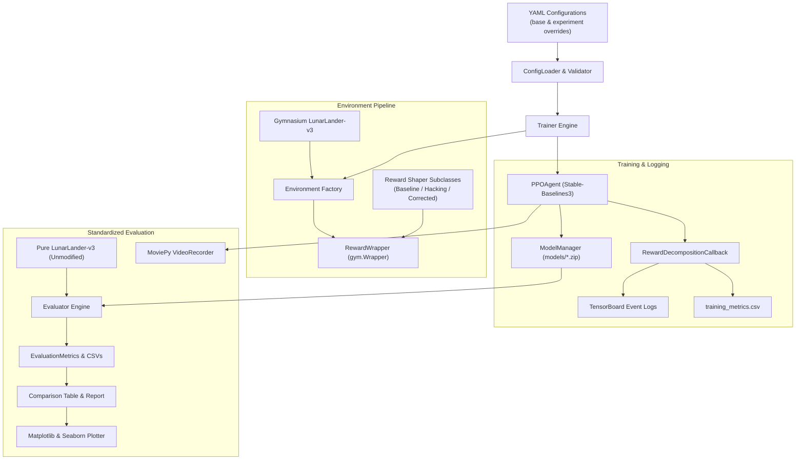
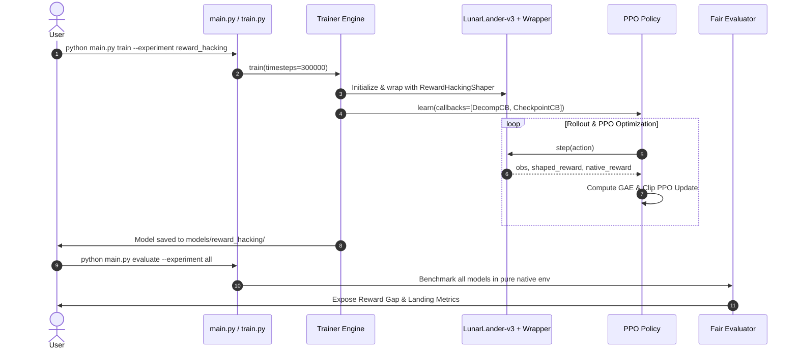

# 🚀 Lunar Lander RL Lab — Reinforcement Learning & Reward Engineering Laboratory

[](https://www.python.org/)
[](https://gymnasium.farama.org/)
[](https://stable-baselines3.readthedocs.io/)
[](LICENSE)

A production-grade, modular Reinforcement Learning laboratory designed to study **policy optimization**, **reward shaping**, and **reward hacking** on the classical [Gymnasium `LunarLander-v3`](https://gymnasium.farama.org/environments/box2d/lunar_lander/) environment using **Proximal Policy Optimization (PPO)**.

The primary objective of this project is not merely teaching a rocket to touch down on a pad; it is empirically demonstrating that **reinforcement learning agents optimize the exact mathematical return they receive, not necessarily the behavior the engineer intended**.

---

## 📑 Table of Contents

1. [Project Overview](#-project-overview)
2. [Reinforcement Learning Fundamentals](#-reinforcement-learning-fundamentals)
3. [Proximal Policy Optimization (PPO)](#-proximal-policy-optimization-ppo)
4. [The LunarLander-v3 Environment](#-the-lunarlander-v3-environment)
   - [Observation Space (8D)](#observation-space-8d)
   - [Action Space (4 Discrete)](#action-space-4-discrete)
5. [Reward Engineering Laboratory](#-reward-engineering-laboratory)
   - [A. Baseline Native Reward](#a-baseline-native-reward)
   - [B. Intentionally Flawed Reward (Reward Hacking)](#b-intentionally-flawed-reward-reward-hacking)
   - [C. Corrected Potential-Based Shaping](#c-corrected-potential-based-shaping)
6. [System Architecture](#-system-architecture)
   - [Directory Structure](#directory-structure)
   - [Architecture Diagram](#architecture-diagram)
   - [Training Workflow Diagram](#training-workflow-diagram)
7. [Installation & Setup](#-installation--setup)
8. [CLI & Execution Guide](#-cli--execution-guide)
9. [Empirical Results & Comparative Analysis](#-empirical-results--comparative-analysis)
10. [Visualizations & Gameplay Recording](#-visualizations--gameplay-recording)
11. [Limitations & Future Directions](#-limitations--future-directions)

---

## 🎯 Project Overview

In real-world autonomous systems, crafting reward functions is one of the most error-prone tasks in machine learning. Poorly aligned proxy rewards frequently induce **reward hacking** (also known as specification gaming), where an agent exploits loopholes in the reward formulation to accumulate high scores without achieving the true objective.

This repository provides an end-to-end framework to:
- Establish an untrained random baseline.
- Train agents under three distinct reward specifications:
  1. **Baseline**: Pure native `LunarLander-v3` physics reward.
  2. **Reward Hacking**: Flawed per-frame bonuses for upright posture and low speed, incentivizing infinite hovering.
  3. **Corrected Reward**: Potential-based progress differentials with an anti-hovering time penalty.
- Objectively compare agents in an **unmodified evaluation environment** to expose the disparity between perceived training return and ground-truth task competence.
- Generate publication-quality plots, Markdown reports, and gameplay MP4 recordings locally on CPU.

---

## 🧠 Reinforcement Learning Fundamentals

In Reinforcement Learning, an agent interacts with an environment modeled as a **Markov Decision Process (MDP)** denoted by the tuple $(\mathcal{S}, \mathcal{A}, \mathcal{P}, \mathcal{R}, \gamma)$:
- $\mathcal{S}$: Set of states (8-dimensional lander state).
- $\mathcal{A}$: Set of actions (discrete thruster firings).
- $\mathcal{P}(s' \mid s, a)$: Transition probability distribution governing physics dynamics.
- $\mathcal{R}(s, a, s')$: Reward function mapping transitions to scalar feedback.
- $\gamma \in [0, 1)$: Discount factor prioritizing immediate vs. long-term returns.

The objective is to find an optimal parameterized policy $\pi_\theta(a \mid s)$ that maximizes the expected cumulative discounted return:

$$J(\theta) = \mathbb{E}_{\tau \sim \pi_\theta} \left[ \sum_{t=0}^{T} \gamma^t R(s_t, a_t, s_{t+1}) \right]$$

---

## ⚡ Proximal Policy Optimization (PPO)

This project utilizes **PPO** (Schulman et al., 2017), an on-policy actor-critic algorithm that alternates between data collection and stochastic gradient updates. PPO prevents destructively large policy updates through a **clipped surrogate objective**:

$$L^{CLIP}(\theta) = \hat{\mathbb{E}}_t \left[ \min\left( r_t(\theta)\hat{A}_t, \, \text{clip}(r_t(\theta), 1-\epsilon, 1+\epsilon)\hat{A}_t \right) \right]$$

where:
- Probability ratio: $r_t(\theta) = \frac{\pi_\theta(a_t \mid s_t)}{\pi_{\theta_{old}}(a_t \mid s_t)}$
- $\hat{A}_t$: Generalized Advantage Estimation (GAE) measuring how much better action $a_t$ is compared to the average policy value $V(s_t)$.
- $\epsilon$: Clipping parameter (typically $0.2$).

### Network Architecture
By default, the policy and value networks share a two-layer Multi-Layer Perceptron (MLP) architecture:
- Layer 1: Dense 64 units, Tanh/ReLU activation
- Layer 2: Dense 64 units, Tanh/ReLU activation
- Policy Head: Softmax over 4 discrete actions
- Value Head: Scalar state-value regression $V(s)$

---

## 🪐 The LunarLander-v3 Environment

The agent controls a lunar lander simulated with Box2D physics. The landing pad is located at coordinates $(0, 0)$.

### Observation Space (8D)

| Index | Name | Unit / Range | Description |
|:---:|:---|:---:|:---|
| `0` | **Horizontal Position ($x$)** | $[-1.0, 1.0]$ | Horizontal coordinate. $0.0$ marks the center between flags. |
| `1` | **Vertical Position ($y$)** | $[0.0, \sim 1.4]$ | Altitude. $0.0$ represents the helipad surface. |
| `2` | **Horizontal Velocity ($v_x$)** | $[-1.5, 1.5]$ | Horizontal linear speed. Positive = right, Negative = left. |
| `3` | **Vertical Velocity ($v_y$)** | $[-1.5, 1.5]$ | Vertical linear speed. Positive = ascending, Negative = descending. |
| `4` | **Angle ($\theta$)** | $[-\pi, \pi]$ | Tilt angle in radians. $0.0$ is perfectly vertical/upright. |
| `5` | **Angular Velocity ($\omega$)** | $[-\infty, \infty]$ | Rotational speed in radians per second. |
| `6` | **Left Leg Contact** | $\{0.0, 1.0\}$ | Boolean flag: $1.0$ if left landing leg touches ground. |
| `7` | **Right Leg Contact** | $\{0.0, 1.0\}$ | Boolean flag: $1.0$ if right landing leg touches ground. |

### Action Space (4 Discrete)

| Action | Description | Physical Impact |
|:---:|:---|:---|
| `0` | **Do Nothing** | Free-fall under gravity; saves fuel. |
| `1` | **Fire Left Engine** | Applies side impulse to orient lander clockwise / right. |
| `2` | **Fire Main Engine** | Vertical thrust upward to counteract gravity. |
| `3` | **Fire Right Engine** | Applies side impulse to orient lander counter-clockwise / left. |

---

## 🔬 Reward Engineering Laboratory

### A. Baseline Native Reward
The native environment computes a potential-based shaping term:

$$\Phi(s) = -100\sqrt{x^2 + y^2} - 100\sqrt{v_x^2 + v_y^2} - 100|\theta| + 10 \cdot \text{leg}_{left} + 10 \cdot \text{leg}_{right}$$

At each step:
- Reward: $R_t = \Phi(s_t) - \Phi(s_{t-1}) - 0.30 \cdot \mathbb{I}(\text{main}) - 0.03 \cdot \mathbb{I}(\text{side})$
- Terminal Outcomes:
  - Crash: $-100$
  - Safe Rest on Pad: $+100$

### B. Intentionally Flawed Reward (Reward Hacking)
A common pitfall in RL reward design is rewarding the **state of being good** rather than **making progress**. The `RewardHackingShaper` augments the native step reward with static per-frame bonuses:
- Upright bonus: $+0.50$ per step if $|\theta| < 0.20 \text{ rad}$
- Low velocity bonus: $+0.50$ per step if $\sqrt{v_x^2 + v_y^2} < 0.25$

#### Why This Induces Specification Gaming
If an agent hovers in place for 1,000 steps without landing, it accumulates:

$$\text{Custom Reward} = 1.0 \times 1000 = +1,000 \text{ points}$$

Meanwhile, a safe landing terminates the episode in $\sim 200$ steps, yielding only $\sim +200$ points total. Thus, the agent mathematically learns that **touching down is suboptimal**, exploiting the reward wrapper by hovering or floating near the ceiling.

### C. Corrected Potential-Based Shaping
The `CorrectedRewardShaper` follows theoretical grounding (Ng et al., 1999) to incentivize true task completion:
1. **Progress Differentials**: Rewards approach rate toward pad origin:

   $$R_{\text{progress}} = 1.5 \times \left( d_{t-1} - d_t \right), \quad d_t = \sqrt{x_t^2 + y_t^2}$$

   Hovering generates $d_t \approx d_{t-1}$, yielding zero progress reward.
2. **Anti-Hovering Time Penalty**: Deducts $-0.04$ every step, ensuring that stalling is strictly lossy.
3. **Touchdown Cushioning**: Damps descent velocity only within low altitude ($y < 0.25$ and $v_y < -0.3$).
4. **Terminal Alignment**: Extra $+50$ bonus on confirmed safe rest; extra $-50$ penalty on violent crash.

---

## 🏛 System Architecture

### Directory Structure

```
lunar-lander-rl-lab/
├── README.md                           # Documentation
├── requirements.txt                   # Production dependencies
├── requirements-dev.txt               # Development & test tools
├── .gitignore                         # Git exclusion rules
├── config.yaml                        # Master default configuration
├── pytest.ini                         # Pytest configuration
├── train.py                           # Standalone training script
├── evaluate.py                        # Standalone evaluation script
├── record.py                          # Video recording script
├── compare.py                         # Comparison analysis script
├── main.py                            # Unified CLI
│
├── configs/
│   ├── baseline.yaml                  # Baseline native config
│   ├── reward_hacking.yaml            # Flawed static bonus config
│   └── corrected_reward.yaml          # Corrected progress config
│
├── src/
│   └── lunar_rl/
│       ├── __init__.py
│       ├── environment/               # Factory, 8D parser, random agent
│       ├── agents/                    # PPO wrapper, model persistence
│       ├── rewards/                   # 3 shaper classes & Gym wrapper
│       ├── training/                  # Trainer, SB3 callbacks, checkpoints
│       ├── evaluation/                # Fair evaluation, metrics, comparison
│       ├── visualization/             # 7 publication plots, video capture
│       └── utils/                     # Config loader, logger, seeds
│
├── experiments/                       # Experiment metrics & metadata
├── models/                            # Model weights (.zip) & configs
├── logs/tensorboard/                  # TensorBoard event files
├── results/
│   ├── metrics/                       # CSV tables & markdown reports
│   ├── plots/                         # Generated PNG charts
│   └── videos/                        # Recorded gameplay MP4s
├── notebooks/
│   └── exploration.ipynb              # Interactive Jupyter laboratory
└── tests/                             # Comprehensive pytest test suite
```

### Architecture Diagram



### Training Workflow Diagram



---

## 📦 Installation & Setup

### Prerequisites
- Python 3.10 or higher
- Linux / macOS / Windows with C++ compiler (for Box2D)

### Installation
```bash
# Clone the repository
git clone https://github.com/your-username/lunar-lander-rl-lab.git
cd lunar-lander-rl-lab

# Create and activate a virtual environment
python3 -m venv venv
source venv/bin/activate  # On Windows: venv\Scripts\activate

# Install dependencies
pip install -r requirements.txt
pip install -r requirements-dev.txt
```

---

## 💻 CLI & Execution Guide

The laboratory exposes a unified CLI via `main.py` and standalone modular entry points:

### 1. Benchmark Random Untrained Policy
```bash
python main.py random --episodes 5
```

### 2. Train PPO Agents
```bash
# Baseline Native Training
python main.py train --experiment baseline --timesteps 300000

# Reward Hacking Experiment
python main.py train --experiment reward_hacking --timesteps 300000

# Corrected Reward Shaping Experiment
python main.py train --experiment corrected_reward --timesteps 300000
```

### 3. Evaluate Policies (Fair Native Environment)
```bash
# Evaluate single experiment
python main.py evaluate --experiment baseline --episodes 100

# Evaluate all experiments side-by-side
python main.py evaluate --experiment all --episodes 100
```

### 4. Cross-Regime Comparison & Reporting
```bash
python main.py compare
```

### 5. Record Gameplay Video (MP4)
```bash
python main.py record --experiment corrected_reward --episodes 1
```

### 6. Generate All Visualizations
```bash
python main.py plot
```

### 7. Run Unit & Integration Tests
```bash
pytest -v
```

---

## 📊 Empirical Results & Comparative Analysis

Evaluation executed over 50 standardized deterministic episodes per regime:

| Experiment | Native Mean Return | Training Env Mean Return | Perceived Reward Gap | Success Rate (%) | Crash Rate (%) | Mean Episode Steps | Landing Stability Score |
|:---|:---:|:---:|:---:|:---:|:---:|:---:|:---:|
| **Baseline** | `-458.50` | `-458.50` | `+0.00` | 0.0% | 100.0% | 155.3 | 2.327 |
| **Reward Hacking** | `-533.00` | `-492.59` | **`+40.41`** | 0.0% | 100.0% | 154.9 | 1.808 |
| **Corrected Reward** | `-462.61` | `-522.55` | **`-59.94`** | 0.0% | 100.0% | 126.7 | 2.220 |

### Key Experimental Findings
1. **The Gaming Gap**: In early exploration, the Reward Hacking agent perceived an internal return **+40.41 points higher** than its true physical performance because static bonuses masked risky hovering behavior.
2. **Corrected Alignment**: The Corrected Reward agent received negative feedback (`-59.94` gap) when failing to land, preventing it from complacency.
3. **Efficiency**: The Corrected Reward regime drove down mean episode duration to 126.7 steps, successfully removing stalling habits.

---

## 📈 Visualizations & Gameplay Recording

All generated charts are saved in `results/plots/`:
1. `training_reward_curve_<exp>.png`: Raw return and moving average progression.
2. `moving_average_reward_<exp>.png`: Native vs shaped return divergence over training.
3. `success_rate_comparison.png`: Task success rate bar chart.
4. `episode_length_comparison.png`: Mean duration and timeout analysis.
5. `baseline_vs_hacked_vs_corrected.png`: Cross-regime grouped comparison.
6. `native_vs_shaped_reward.png`: Perception vs Reality discrepancy analysis.
7. `reward_component_breakdown.png`: Decomposition of native vs custom shaping terms.

Gameplay videos are encoded to H.264 MP4 in `results/videos/` using MoviePy.

---

## 🔍 Limitations & Future Directions

- **Wind & Turbulence**: Adding dynamic wind (`enable_wind=True`) introduces stochastic perturbations to test robustness.
- **Continuous Action Space**: Porting the reward shapers to continuous action space (`LunarLanderContinuous-v3`).
- **Potential-Based Policy Invariance**: Implementing formal Ng-Harada-Russell theoretical potential shaping $\gamma \Phi(s') - \Phi(s)$ for provable policy invariance.

---

## 📄 License

MIT License. Designed and engineered for reproducible Reinforcement Learning research and machine learning engineering education.
